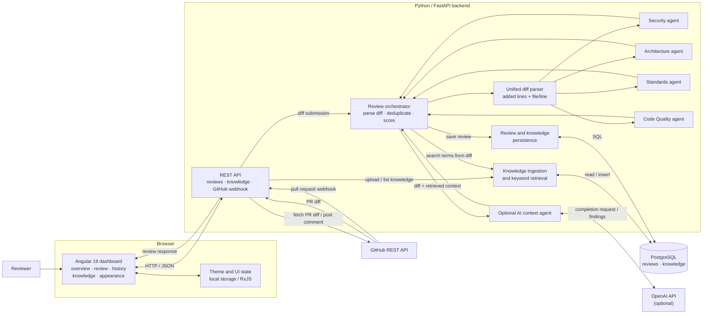

# Project architecture

This diagram shows the current runtime components and the main review and
knowledge flows. The browser talks to FastAPI over HTTP/JSON; FastAPI persists
records in PostgreSQL and calls GitHub or OpenAI only for the corresponding
optional workflows.

## Component responsibilities

- **Angular dashboard:** presents the user flows and calls the REST API through
  `frontend/src/app/review.service.ts`. Its theme selection is browser-local
  and does not go through the backend.
- **FastAPI:** validates request models, exposes health/review/knowledge/GitHub
  endpoints, initializes tables and ingests knowledge files at startup.
- **Review orchestrator:** turns a unified diff into added-line records,
  retrieves context, runs specialist rules, optionally invokes OpenAI,
  deduplicates/sorts findings, computes a score, and saves the result.
- **Knowledge subsystem:** stores uploaded or startup-ingested documents in the
  `knowledge` table and finds matching excerpts using simple keyword overlap.
- **PostgreSQL:** durable store for saved review records and knowledge text.
- **GitHub integration:** fetches pull-request diffs and can publish a comment.
  Webhook requests enter through FastAPI and trigger a fetch-and-review flow.
- **OpenAI integration:** optional. It receives a truncated diff and retrieved
  project context and can return additional findings.

## Primary data flows

### Analyze a diff

`Reviewer → Angular review form → POST /api/reviews/analyze → diff parser →
specialist agents (+ optional context agent) → scoring and persistence →
review results UI`

### Analyze a GitHub pull request

`Angular → FastAPI PR analysis endpoint → GitHub diff API → review flow →
PostgreSQL → Angular results`

If requested, FastAPI also posts the review summary as a GitHub issue comment.
The saved-review comment endpoint uses the stored PR association and findings.

### Add project knowledge

`Knowledge page upload` or `backend/knowledge/ file at startup → UTF-8 text →
knowledge table → keyword retrieval during review → optional context agent`

## Runtime topology

Docker Compose defines three services:

- `frontend`: Angular dev server on port `4200`.
- `backend`: FastAPI on port `8000`.
- `db`: PostgreSQL on port `5432`, with a named volume for database data.

The backend waits for the database health check. The frontend uses its configured
API base URL, currently `http://localhost:8000/api`.
